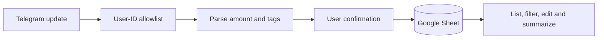

<div align="center">

# Telegram Expense Tracker

**Log an expense in chat. Keep the ledger in your Google Sheet.**

Send an amount, a description and optional tags—confirm it, then get back to your day.

[](requirements.txt) [](bot.py) [](expenses.py)

[**See the commands**](#from-message-to-ledger) · [**Try parsing offline**](#try-the-message-format-without-credentials) · [**Connect the bot**](#connect-telegram-and-google-sheets)

</div>

## From message to ledger

Capturing a small purchase should not require opening a spreadsheet and finding the next row. This personal bot accepts a short Telegram message, asks for confirmation and writes the entry to a Google Sheet. You can list, filter, edit, delete and summarize that shared ledger from the same chat.

| Capture quickly | Review in chat | Keep the data accessible |
| --- | --- | --- |
| Amount + description + `#category` + `@notes` | Confirmation, recent entries, filters and category totals | Ordinary Google Sheet rows; one sheet shared by allowlisted users |

```text
1,200 coffee #food @with friends
           ↓ parse and confirm
Amount: 1200 · Reason: coffee · Category: food · Notes: with friends
```

<details>
<summary><strong>Supported commands and date formats</strong></summary>

| You send | What happens |
|---|---|
| `120 coffee #food @with friends` | Asks for confirmation, then appends amount `120`, description `coffee`, category `food`, notes `with friends` |
| `1,200 rent #home` | Separators are understood (`1,200`, `1,20,000`, `1,234.50`) |
| `/list [n]` | The last *n* entries (default 10, max 50), with Update and Delete buttons |
| `/list_filter` | Step-by-step filter by date, category, amount or description |
| `/list_filter date last month` | Text filters. See `/help_filters` for every format |
| `/summary [period]` | Totals per category. Default is this month. Also takes `last month`, `August 2025`, `01-08-2025 to 15-08-2025`, … |
| `/update <row> <expense>` · `/delete <row>` | Edit or remove a row by its sheet row number |
| `/list_categories` · `/sheet` · `/help` | Categories used so far, a link to the sheet, and help |

Dates accept `dd-mm-yyyy`, `yyyy-mm-dd`, `mm-yyyy`, month names (`Aug 25`), `today`, `yesterday`, `this week`, `last week`, `this month`, `last month`, and ranges joined with `to`.

</details>

## Try the message format without credentials

Use Git and Python; Python 3.13 is the verified local environment. The pure parser does not import Telegram or Google clients:

```sh
git clone https://github.com/Muneer320/Telegram-Expence-Tracker.git
cd Telegram-Expence-Tracker
python -c "from expenses import parse_message; print(parse_message('1,200 coffee #food @with friends'))"
```


*Real output from `expenses.py`; this is not a screenshot of a live Telegram conversation. No credentials or external calls are used.*

## How the entry reaches the sheet



`bot.py` handles Telegram/Google calls. [expenses.py](expenses.py) contains pure parsing, date ranges, filters, summaries and Markdown escaping. Commands read the sheet once; confirmed additions append a row and deletions remove the selected row. Pending confirmations and filter flows live in memory and are cancelled by a restart; saved sheet rows remain.

## Connect Telegram and Google Sheets

> [!IMPORTANT]
> **The allowlist is required.** An empty `ALLOWED_USER_IDS` denies every user; rejected users can see their own Telegram ID for setup. All allowed users share the same sheet and can operate on that ledger. This is a trusted personal/shared-sheet bot, not isolated per-user accounts.

<details>
<summary><strong>BotFather, service account, sheet headers and environment setup</strong></summary>

1. Create a bot with [@BotFather](https://t.me/BotFather).
2. Create a Google Cloud service account and download its JSON key. Make a sheet with the header row `Timestamp | Amount | Reason | Category | Notes | User`, and share it with the service account's email.
3. Copy `.env.example` to `.env` and fill it in. Leave `ALLOWED_USER_IDS` empty at first.
4. Run it:
   ```sh
   pip install -r requirements.txt
   python bot.py
   ```
5. Message the bot. It replies that it's private and tells you your user id. Put that id in `ALLOWED_USER_IDS` and restart.

The `Procfile` runs it as a long-polling worker, which suits Heroku, Railway and similar hosts.

</details>

[.env.example](.env.example) documents `TELEGRAM_BOT_TOKEN`, `SPREADSHEET_KEY`, `GOOGLE_SA_JSON` and `ALLOWED_USER_IDS`. Keep real tokens/service-account JSON private. Expense messages pass through Telegram and entries are sent to Google Sheets; this is not an on-device-only ledger. A live Telegram/Google connection has not been verified by the offline checks.

Amounts are displayed in rupees; there is no currency-conversion system. The ledger belongs to the configured sheet, not a separate account for each Telegram user.

## Verify and contribute

After installing `requirements.txt`, run:

```sh
pip install pytest
python -m pytest tests
```

`tests/test_expenses.py` covers parsing, dates, filters and summaries. `tests/test_bot_smoke.py` imports the bot against a fake sheet and drives the handlers: the access guard, the add confirmation, list, delete, filters and summary.

For a bug, open an [issue](https://github.com/Muneer320/Telegram-Expence-Tracker/issues) with a synthetic message, command and expected result. For a focused PR, run the parser/handler tests and document changed commands or environment names. Never attach real service-account keys or a private expense sheet.

A personal project by [Muneer Alam](https://github.com/Muneer320). The repository does not currently include a license file. The repository slug retains its original spelling, `Telegram-Expence-Tracker`.
